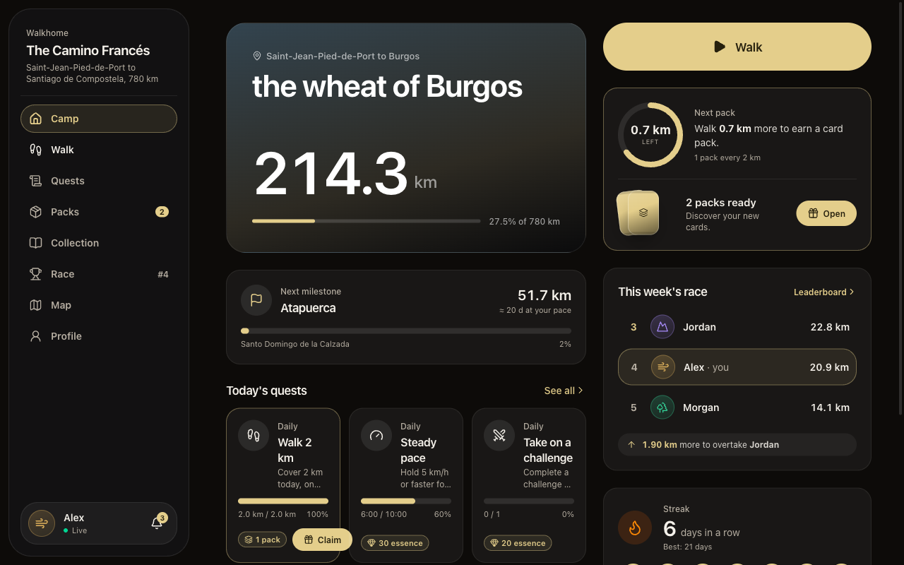
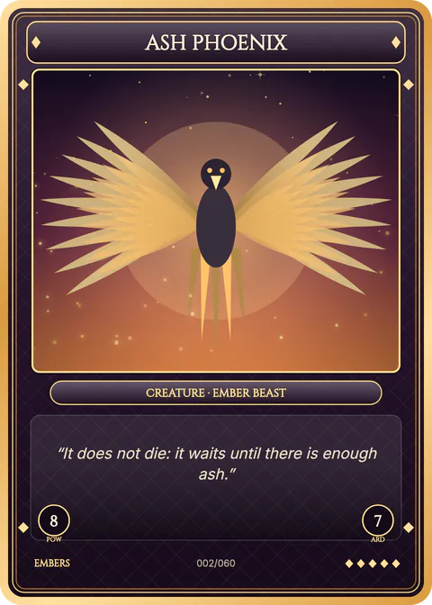

# Walkhome

A self-hosted, gamified walking quest for a home treadmill.

Walkhome runs on a Raspberry Pi next to the treadmill, reads live telemetry over
Bluetooth (FTMS), and turns the kilometres you actually walk into progress along a
real pilgrimage route, the 780 km Camino Francés to Santiago de Compostela: story milestones, in-walk challenges, daily and weekly
quests, collectible card packs earned by walking, and a leaderboard for everyone in
the household. Phones, tablets and the TV are just browsers on the local network.



| | |
|---|---|
|  |  |

## Features

- **Accounts for the whole household.** Username + password; each player has their own
  journey, sessions, packs and notifications. Others only see a public profile and the leaderboard.
- **Live walks.** One treadmill, one walker at a time: whoever is walking holds it, everyone else
  sees who. A 1 Hz HUD shows speed, pace, distance, heart rate and the road ahead.
- **A journey made of data.** The default `camino` theme follows the Camino Francés from
  Saint-Jean-Pied-de-Port to Santiago (about 780 km) in four stages and ~20 biomes: real places,
  story beats, the route's real variants as choices, and "hold this pace / this incline" challenges
  on its climbs (the Pyrenees, Alto del Perdón, O Cebreiro). Themes are pure JSON, so the app itself
  is theme-agnostic.
- **Trading cards.** "Embers & Peaks", 120 original, procedurally generated cards in two sets, with holographic foils rendered in
  WebGL. The **server** rolls every pack (odds, pity timers, duplicates turned into essence, crafting);
  the client only animates the result.
- **Rewards, quests, streaks, leaderboard.** All rewards are derived and idempotent; overtakes and a
  weekly podium award packs; optional Web Push notifications.
- **Installable PWA** with a mobile-first UI and a real desktop layout.

## Hardware

- A treadmill that exposes the **Bluetooth Fitness Machine Service (FTMS)**. Many recent walking pads
  and treadmills do (often the ones paired with a vendor phone app).
- A **Raspberry Pi** (a Pi 4 is plenty) with Bluetooth, on the same network as the phones.
- Optional: a heart-rate value reported by the treadmill.

Walkhome **never writes** to the treadmill's FTMS Control Point: it cannot change the belt speed or
the incline. Every challenge is "hold this pace yourself". See [docs/DESIGN.md](docs/DESIGN.md).

## Quick start (no treadmill needed)

Requirements: Python 3.9+ with `hashlib.scrypt` (any OpenSSL-based CPython) and Node.js 20+.

```bash
python3 -m venv .venv
.venv/bin/pip install -r requirements.txt
.venv/bin/python tools/build_content.py         # generate the journey pack
(cd frontend && npm ci && npm run build)        # build the React UI
.venv/bin/python -m app                         # http://localhost:8090, simulator on
```

Open `http://localhost:8090`, **register** (the first account becomes admin) and start a walk.
The built-in treadmill simulator produces telemetry; drive it while testing (any signed-in user
can, since `WALKHOME_DEV` is on by default; with curl use `-b cj` after
`POST /api/auth/login -c cj`):

```bash
curl -b cj -X POST localhost:8090/api/dev/sim -H 'Content-Type: application/json' \
     -d '{"speed_kmh": 8}'                       # set the belt speed
     -d '{"drop_link_s": 10}'                    # simulate a BLE dropout
     -d '{"reset_console": true}'                # simulate a console reset
```

To work on the UI without a backend, run `npm run dev` in `frontend/` and open `/?mock=1`
(see [frontend/README.md](frontend/README.md)).

### Demo data (dev only)

```bash
.venv/bin/python tools/seed_demo.py --db data/walkhome.db --reset
```

creates six fictional players (`ada`, `ben`, `cleo`, `dev`, `eve`, `finn`, password
`demo-password`) with walks over the last three weeks, rewards paid by the real engine and some
packs opened, which gives you a living leaderboard. Demo accounts are never admin, and the script
refuses to run on a database holding real accounts unless `--force`.

## Real treadmill (FTMS over BLE)

1. **Probe first** (read-only): `.venv/bin/python tools/probe_ftms.py` verifies your device's flag
   bits, distance resolution and reset behaviour.
2. Run with `WALKHOME_BLE=auto` (and optionally `WALKHOME_DEVICE_ADDRESS=AA:BB:...`). Close the
   vendor's phone app first: FTMS treadmills accept a single BLE client.

## How distance is counted

- **Primary**: instantaneous speed integrated over time (immune to console resets, smooth enough
  for the live scene).
- **Cross-check**: the treadmill's cumulative Total Distance field, accumulated as positive deltas
  only. A console reset can never subtract, and reconciliation recovers metres walked during a BLE
  dropout.
- A *pause* is a live link reporting speed 0; a *dropout* is the absence of notifications. They are
  distinct states and neither counts distance.
- The live session checkpoints to SQLite (WAL) every few seconds; a power cut or a reboot resumes the
  walk within seconds of where it stopped.
- Journey progress is always **derived** (sum of sessions + adjustments, × per-walker handicap), so
  correcting or deleting a session is safe.

## Accounts, privacy, isolation

- Passwords are `scrypt`-hashed; session tokens are random and only their SHA-256 is stored.
  Cookie `wh_session` (HttpOnly, SameSite=Lax, `Secure` behind an HTTPS proxy via
  `x-forwarded-proto`) or `Authorization: Bearer`.
- Everything private lives under `/api/me/*` and the per-user WebSocket: a player can never read or
  change another player's sessions, packs, collection or notifications. Only the person walking
  receives the 1 Hz `tick`; everyone gets a minimal presence message (`live`).
- Upgrading from a v1 database migrates it in place (`SCHEMA_VERSION = 2`, nothing is deleted); old
  walkers become claimable accounts (`POST /api/auth/claim`). See [docs/DEPLOY.md](docs/DEPLOY.md).

## Rewards, cards, quests

A pack every `rewards.pack_every_m` (2 km by default, set per theme in the content pack) of credited
distance, a daily pack for the first km of the day, streak tiers (3/7/14/30/60/100 days), journey
milestones, album completion (25/50/75/100%), overtakes (max 3/day), the weekly podium and 2 welcome
packs. Manual entries count for progress and ranking but are **capped for rewards** (5 km/day;
implausible speeds are worth 400 m). Each pack holds 5 cards, with pity every 5/25 openings;
duplicates become essence, and essence crafts missing cards. A theme's catalog is
`content/cards/<theme>.json`; a theme without one simply cannot be drawn from.
The full API/WebSocket contract is in [docs/CONTRACT.md](docs/CONTRACT.md); card generation is
described in [docs/CARDS.md](docs/CARDS.md).

## Configuration

Environment variables (all optional): `WALKHOME_BLE` (`sim`/`auto`/`off`),
`WALKHOME_DEVICE_ADDRESS`, `WALKHOME_DB`, `WALKHOME_PORT`, `WALKHOME_UNITS` (`km`/`mi`),
`WALKHOME_PACK` (default theme, `camino`), `WALKHOME_DEV` (`0` restricts the simulator endpoint
to admins), plus:

| Variable | Default | Role |
|---|---|---|
| `WALKHOME_TZ` | `Europe/Paris` | defines "today", "this week" (Monday 00:00), the daily pack and the 19:00 streak reminder |
| `WALKHOME_REGISTRATION` | `open` | `open`, `invite` (needs `invite_code` = `WALKHOME_INVITE_CODE`) or `closed` |
| `WALKHOME_INVITE_CODE` | _(empty)_ | invite code for `invite` mode (empty = nobody can register) |
| `WALKHOME_SESSION_DAYS` | `90` | sliding session lifetime |
| `WALKHOME_MANUAL_CAP_M` | `5000` | manual metres per day that may earn rewards |
| `WALKHOME_VAPID_SUBJECT` | `mailto:admin@walkhome.local` | VAPID contact for Web Push |

Web Push is optional: VAPID keys are generated in `data/vapid.json` on first start (back that file
up: losing it unsubscribes every device); without the `pywebpush` package the app still runs and
reports `push.supported = false`. See `app/config.py` for the full list.

## Deployment on a Raspberry Pi

```bash
sudo cp deploy/walkhome.service /etc/systemd/system/
sudo systemctl daemon-reload && sudo systemctl enable --now walkhome
# nightly DB backup (safe while walking):
crontab -e   # 0 3 * * * /home/pi/workspace/walkhome/deploy/backup.sh
```

For PWA install and the screen wake lock on iPhone you need HTTPS on the LAN; Tailscale
(`tailscale cert` / `tailscale serve`) is the least-friction option. Everything else works over plain
HTTP. Step by step: [docs/DEPLOY.md](docs/DEPLOY.md).

## Tests

```bash
.venv/bin/python -m pytest tests/ -q             # backend (~170 tests)
(cd frontend && npm run build && npm run lint)   # type-check, bundle, lint
python3 -I tools/validate_cards.py               # card catalog and images
```

The backend tests cover FTMS decoding, distance accounting (dropouts, console resets, reboot
recovery), challenges, the event engine, the content pack, the v1→v2 migration, auth, per-user
isolation (HTTP and WebSocket), idempotent rewards, the card draw (odds, pity, duplicates, craft),
quests, the leaderboard (overtakes, podium), notifications/push and the HTTP/WebSocket API.

## Architecture

```
app/        Python backend (FastAPI + bleak, one asyncio process).
            Telemetry: ftms, ble, tracker, challenges. Orchestration: service
            (+ players, walk_events, views mixins). Accounts: auth.
            Game: rewards, cards, quests, leaderboard, profiles, stats.
            Delivery: notifications, push, hub (per-user WebSocket), server.
            Data: db (SQLite, schema v2 + migrations), content, config, timeutil.
content/    journey pack (generated by tools/build_content.py) and card catalog
frontend/   React + Tailwind + three.js PWA (Vite; npm run build -> dist/,
            served by FastAPI)
tools/      build_content.py (journey generator), build_cards.mjs
            (card generator), validate_cards.py, probe_ftms.py (device probe),
            seed_demo.py (demo players), build_icons.py
tests/      pytest suite
deploy/     systemd unit, backup script
docs/       design notes, API contract, cards, deployment
```

The Pi is the single source of truth: clients receive a full snapshot over the WebSocket, then
sequenced incremental messages, and every command goes through the server. Design rationale (safety,
distance accounting, robustness) is in [docs/DESIGN.md](docs/DESIGN.md).

## Assets

- Fonts: Inter and Cinzel, both under the SIL Open Font License.
- 3D walker and staff models: KayKit Adventurers (CC0), see `frontend/public/models/LICENSE-kaykit.txt`.
- Card art, pack wrappers and journey text are generated by the scripts in `tools/`; the journey's
  text is original, and its distances follow common Camino guidebook figures.

## License

Code: MIT, see [LICENSE](LICENSE). Fonts: SIL Open Font License (`frontend/public/fonts/OFL-*.txt`). 3D models: CC0 (KayKit).
